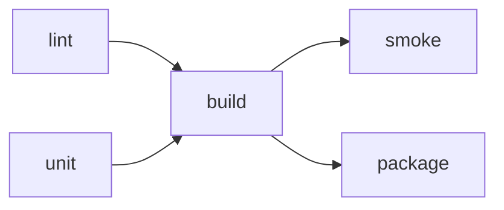

# Task Relay

[](https://github.com/Dcastroro/task-relay/actions/workflows/ci.yml)

**One task graph. Predictable execution. A report your CI can read.**

Task Relay is a small, dependency-free runner for development workflows.
Describe commands and their prerequisites in JSON, inspect the plan, then run
ready tasks in parallel. Failed prerequisites block dependent work while
independent tasks continue.

Node.js 22+ · Windows and Linux CI · no service or API key required.



## Try it

```sh
git clone https://github.com/Dcastroro/task-relay.git
cd task-relay
npm ci --ignore-scripts
npm run plan
npm run demo
```

The included demo simulates five steps with short delays. It does not build,
test or package a real application.

```text
RUNNING lint
RUNNING unit
PASSED lint
PASSED unit
RUNNING build
PASSED build
RUNNING smoke
RUNNING package
PASSED smoke
PASSED package
PASS: 5 task(s) in <elapsed>ms.
```

Completion order and elapsed time vary. `plan` reads and validates the graph
without starting any commands.

## Define your workflow

Save `task-relay.json` in your application directory:

```json
{
  "version": 1,
  "concurrency": 2,
  "tasks": {
    "syntax": {
      "command": ["$node", "--check", "src/index.mjs"]
    },
    "test": {
      "command": ["$node", "--test"],
      "timeoutMs": 60000
    },
    "build": {
      "command": ["$node", "scripts/build.mjs"],
      "needs": ["syntax", "test"],
      "timeoutMs": 60000
    }
  }
}
```

The application paths above are illustrative: replace them with your project's
actual files. From the Task Relay checkout:

```sh
node bin/task-relay.mjs plan --config /path/to/app/task-relay.json
node bin/task-relay.mjs run build --config /path/to/app/task-relay.json --concurrency 2
```

Selecting `build` also selects its prerequisites; unrelated tasks are omitted.
Omit targets to run the entire graph. Shared prerequisites execute once per run.
Quote paths containing spaces.

## Configuration reference

| Field | Default | Meaning |
| --- | --- | --- |
| `version` | Required | Must be `1` |
| `concurrency` | `2` | Maximum active tasks, from 1 to 32 |
| `tasks` | Required | Object containing 1–200 named tasks |
| `command` | Required per task | Array: executable followed by separate arguments, at most 128 strings |
| `needs` | `[]` | Unique names of prerequisite tasks |
| `cwd` | `"."` | Working directory relative to the configuration file |
| `timeoutMs` | `30000` | Hard deadline per task, from 1 to 3,600,000 ms |

Names start with an ASCII letter, contain only letters, digits, `.`, `_`, or
`-`, and are at most 64 characters. Unknown fields are rejected to catch typos.
Unknown dependencies, cycles and invalid tasks fail validation before anything
runs, even if the invalid task is outside the selected targets.

Configuration files must be regular UTF-8 JSON files of at most 128 KiB.
The JavaScript API does not impose a byte limit on an already parsed object.
Each command argument is at most 8,192 characters; platform command-line limits
can be lower. Null bytes are rejected.

## Commands and portability

`$node` is a special executable token resolved to the Node.js binary running
Task Relay. It avoids depending on a separate `node` entry in `PATH`.
Other executables are resolved using the inherited environment.

Commands are argument arrays and run with `shell: false`. Task Relay does not
expand variables, pipes, redirects, globs or `&&`. It inherits the current
environment and does not load `.env` files. Interactive stdin is disabled.

Windows `.cmd` and `.bat` wrappers, including `npm.cmd`, require an explicit
command interpreter. For portable Node workflows, invoke your JavaScript
entry point with `$node`. You can explicitly invoke a shell as the executable,
but then its quoting and interpretation rules are your responsibility.

Task Relay executes trusted project commands with your user permissions. It
does not sandbox code, roll back side effects, deploy applications or provide
automatic retries. Review configurations before running an unfamiliar project.

## Failure, timeout and cancellation

- A non-zero exit code or spawn error marks that task `failed`.
- A deadline marks it `timed-out` and attempts to stop its process tree.
- Descendants of failed/timed-out/skipped tasks are `skipped`.
- Other independent tasks continue so a run can surface several failures.
- `Ctrl+C` or `SIGTERM` cancels queued work and stops active tasks. A final
  report is produced when the signal reaches Node; interrupted runs exit 130.

On POSIX, tasks use their own process group; on Windows, cancellation uses
the system `taskkill /T /F` command. This covers ordinary descendants. A process
that deliberately detaches or escapes the group/tree is outside the cleanup
guarantee. Operating-system forced termination of Task Relay cannot produce a
final report. These controls are intended for finite tasks, not daemon hosting.

Try a failure without touching your own application:

```sh
node bin/task-relay.mjs run --config examples/failure.json
```

This deliberately exits 1: `test` fails, `build` is skipped and `docs` passes.

## Reports and logging

```sh
node bin/task-relay.mjs run --config examples/pipeline.json --json
```

`--json` prints exactly one JSON document to stdout. Reports include schema
version, task names, status counts, exit codes and duration. Command arguments,
paths and child output are excluded. Task ordering follows declaration order;
durations and observed outcomes naturally vary. See [report examples](docs/reports.md).

Human output shows task transitions. Add `--verbose` to forward child output
to stderr, with task labels and a combined 64 KiB cap per task. Excess output
is drained and discarded. `--json` and `--verbose` cannot be combined.
Verbose output can contain anything your commands print, including secrets;
Task Relay does not redact it.

| Exit | Meaning |
| --- | --- |
| `0` | All selected tasks passed, or plan validation succeeded |
| `1` | One or more tasks failed, timed out or were skipped |
| `2` | Usage/configuration/read error |
| `130` | Interrupted execution |

`--help` and `--version` work without a configuration file and print text.
See [integration examples](docs/integrations.md) for CI and Env Contract Check.

## JavaScript API

```js
import { createPlan, runTasks } from './src/index.mjs';

const config = {
  version: 1,
  tasks: { version: { command: ['$node', '--version'] } }
};

const plan = createPlan(config); // Validation only; starts no commands.
const report = await runTasks(config, {
  baseDir: process.cwd(),
  concurrency: 2,
  targets: ['version']
});
console.log(report.ok);
```

`runTasks` accepts an `AbortSignal`, `onEvent` for transitions and `onOutput`
for bounded output forwarding. Callbacks should not throw. Configuration
errors throw `ConfigError`; command failures are returned in the report.

Custom integrations can inject `executor(task, options)`. It must resolve to a
terminal `status` (`passed`, `failed`, `timed-out`, `skipped` or `cancelled`), an
integer/null `exitCode` and a finite nonnegative `durationMs`. A passed result
requires exit code 0. Malformed results become a failed task with fixed reason
`executor-invalid-result`; descendants are skipped while independent tasks finish.
Rejected executors use `executor-error` without copying exception details.

## Development and scope

```sh
npm ci --ignore-scripts
npm run check
```

The test suite covers scheduling, cycle detection, failures, literal arguments,
bounded logs, process cleanup, cancellation and CLI integration. CI runs on
Ubuntu and Windows with Node.js 22 and 24. The POSIX CLI signal test is skipped
on Windows, where programmatic abort is tested instead.

Task Relay also runs its own CI: `npm run pipeline -- --verbose` uses the root
`task-relay.json` to run syntax checks and tests in parallel, then the demo
checks. `npm run check` remains a separate direct check for troubleshooting.

This first release runs from source; it is not published to npm. It targets
small local and CI task graphs. Caching, remote workers, file watching,
retries and matrix expansion are outside its scope.

See [the roadmap](ROADMAP.md), [contribution guide](CONTRIBUTING.md) and
[security notes](SECURITY.md). MIT license. Created by David Castro.

## Repository and release checks

Run `npm run repo:check` before committing. Source releases are built from a
clean, tested tag and include a checksum and commit manifest. See
[RELEASING.md](RELEASING.md) for validation, publication and maintenance.
